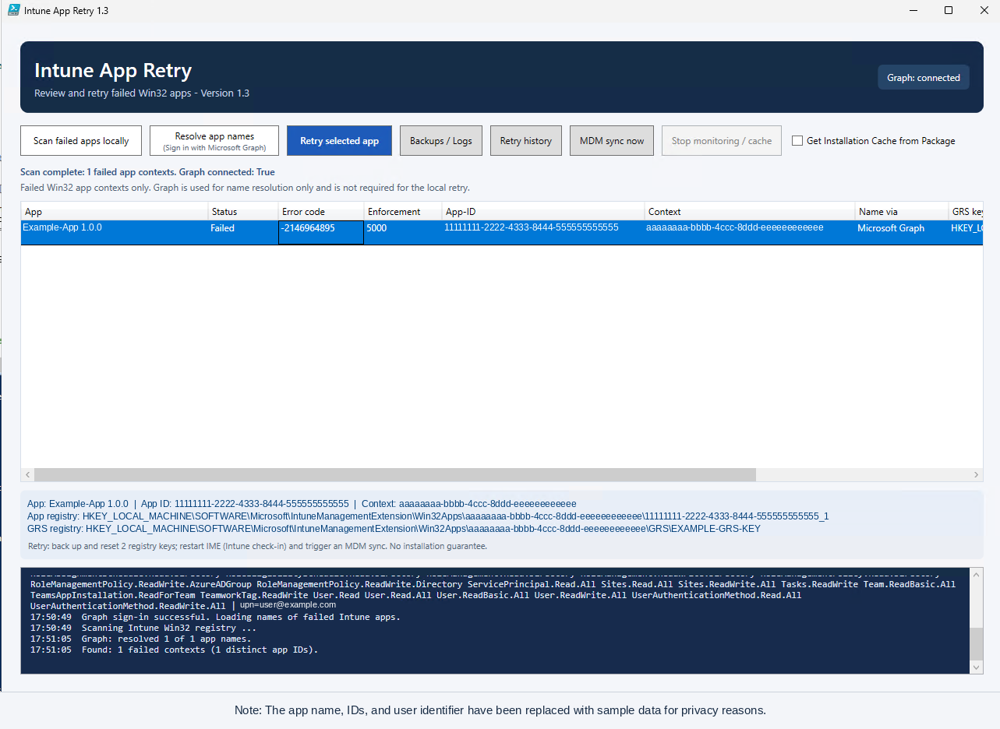
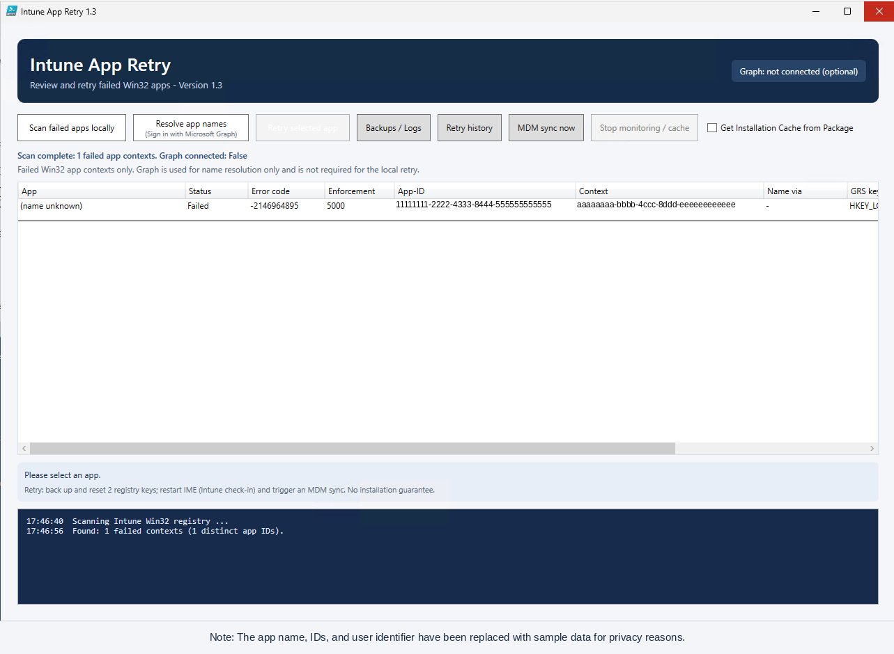

# Intune App Retry

WPF-based PowerShell tool (single file) for IT support to **troubleshoot and re-trigger failed Intune Win32 app installations** locally on a Windows client – with registry backups, live monitoring and installation cache capture.

> ⚠️ **Disclaimer:** Deleting Intune Management Extension (IME) registry keys is an **unsupported troubleshooting workaround**. A reset does not guarantee installation success. Use at your own risk.



## Contents

- [Quick start](#quick-start)
- [Requirements](#requirements)
- [Overview](#overview)
- [Screenshots](#screenshots)
- [Features](#features)
- [How it works](#how-it-works)
- [Safety measures](#safety-measures)
- [Data locations](#data-locations)
- [Troubleshooting](#troubleshooting)
- [Changelog](#changelog) · [License](#license)

## Quick start

1. Download `IntuneAppRetry.ps1` from the [latest release](https://github.com/ditorsahiti/IntuneAppRetry/releases/latest).
2. Open Windows PowerShell **as administrator** and run:

   ```powershell
   powershell.exe -STA -ExecutionPolicy Bypass -File .\IntuneAppRetry.ps1
   ```

3. The tool scans automatically on start. Use **Cancel** to stop a running scan.
4. *(Optional)* Click **Resolve app names** and sign in with the displayed device code (or click **Cancel sign-in**).
5. Select a failed app, click **Retry selected app** and confirm.
6. Watch the live monitor or open **Retry history** later.

## Requirements

- Windows 10/11, Intune-managed (IME installed)
- Windows PowerShell 5.1, **64-bit**, **STA**
- Local administrator rights
- For Graph name resolution (optional):
  - An Entra ID account authorized to read the relevant Intune apps (e.g. a read-only Intune role)
  - Delegated Microsoft Graph permission `DeviceManagementApps.Read.All` with administrator consent
  - **Device Code Flow** allowed in the tenant (not blocked by Conditional Access) for the Microsoft Graph Command Line Tools client (`14d82eec-204b-4c2f-b7e8-296a70dab67e`)

## Overview

When a Win32 app installation fails, the Intune Management Extension only retries it according to its internal retry schedule. This can take hours. Intune App Retry gives support staff a guided, safeguarded way to:

- **find** all failed Win32 app installations on the device,
- **identify** them by name (via Microsoft Graph, IME logs or the local IME log cache),
- **reset** the local app policy state (app result key + GRS key) with a verified backup,
- **re-trigger** the installation without waiting for the retry schedule (IME restart + MDM sync),
- **monitor** the new installation attempt live,
- **capture** the downloaded installation package for analysis,
- **document** every action in audit logs and a retry history.

Everything runs locally in a single PowerShell file with a WPF GUI. No modules or installation required.

## Screenshots

**Local scan (without Graph)** – failed app detected, name unknown:



**With Graph name resolution** – app name resolved via Microsoft Graph:


## Features

| Step | Description |
|------|-------------|
| **Scan** | Reads the IME registry (`Win32Apps`) and lists failed app contexts with readable status (Waiting / Pending / Installing / Installed / Failed), error code and enforcement state. |
| **Names** | Optional: resolves app names via Microsoft Graph (Device Code Flow sign-in, read-only `DeviceManagementApps.Read.All`, requires an account authorized to read Intune apps). Falls back to names from the registry and IME logs. |
| **Retry** | Backs up and deletes the app result key and GRS key of the selected app, restarts IME and triggers an MDM sync so the installation is re-evaluated. |
| **Monitor** | Live monitor after a retry (every 15 s, max. 30 min). Reads all registry contexts and new IME log entries and writes the outcome to the manifest. |
| **History** | Lists all retries from the backup manifests (time, operator, app, outcome). |
| **Cancel** | One context-aware button: cancels a running scan, Graph sign-in or MDM sync, or stops monitoring / cache copying after a retry. Never cancels a running registry reset or the Intune installation. |
| **Cache capture** | Optional: copies the app's `C:\Windows\IMECache\<AppId>[_version]` folders during retry/monitoring to `C:\Temp\IntuneAppRetry-Cache` (best effort). |

## How it works

### 1. Scan for failed apps

The tool reads all user and device contexts under `HKLM\SOFTWARE\Microsoft\IntuneManagementExtension\Win32Apps` and evaluates each app's compliance and enforcement state. For every app it shows:

- readable status (Waiting / Pending / Installing / Installed / Failed),
- error code and enforcement state,
- app ID, context (user/device) and the matching GRS key,
- the source of the app name (Graph, IME log or unknown).

Only **failed** app contexts are listed. The scan is read-only.

### 2. Resolve app names (optional)

App names are not always available in the local registry. If missing, they are resolved:

1. **Locally** from IME log files (no sign-in required).
2. **Via Microsoft Graph** after clicking **Resolve app names**. The tool starts a Device Code Flow, shows the code in the GUI (with copy and open-login buttons) and queries `deviceAppManagement/mobileApps` with read-only permissions.

Tokens and device codes stay in memory only. Graph is never required for the retry itself.

### 3. Reset the app policy state (Retry)

After selecting a failed app and confirming, the tool:

1. Checks that no other app installation is currently running.
2. Stops the Intune Management Extension service.
3. Re-reads the registry with IME stopped and aborts if anything changed since the scan.
4. Exports the **app result key** and the **GRS key** to `.reg` files and writes a `manifest.json` with SHA256 hashes, operator, computer and app details.
5. Validates every path (GUID format, correct context, no shared GRS key) and deletes exactly these two keys.
6. Attempts to restart IME in a `finally` block (also when the reset fails), which requests a new check-in and re-evaluation of the app.
7. Triggers an MDM sync via the enrollment scheduled task.

Result: IME typically treats the app as not yet attempted and re-evaluates it at the next check-in instead of waiting for the retry schedule. Installation success is not guaranteed.

### 4. MDM sync

**MDM sync now** starts the enrollment client's sync task (`\Microsoft\Windows\EnterpriseMgmt\<id>\Schedule #3 created by enrollment client`), the same as *Company Portal > Settings > Sync*. It can also be used on its own without a retry.

### 5. Live monitor

After a retry, a live monitor checks the app every 15 seconds for up to 30 minutes:

- reads the newly created app key in all contexts,
- parses new IME log entries since the retry,
- shows the status timeline (e.g. `Waiting > Installing > Installed`) and elapsed time,
- writes the final outcome (Installed / Failed again / Timeout) to the backup manifest.

The monitor can be stopped or hidden at any time.

### 6. Installation cache capture (optional)

IME usually removes these files after the installation, so capturing them during the run helps keep the downloaded package (installer, scripts, detection files) for troubleshooting.

The capture runs in the background, independent of the GUI, and checks for junctions and symbolic links. It is best effort: very fast installations may finish before everything is copied.

### 7. Retry history and logs

- **Retry history** lists all retries from the backup manifests: time, operator, computer, app, outcome, app ID and context. You can open the backup folder from there.
- **Backups / Logs** opens `C:\ProgramData\IntuneRetryCenter`, which contains the session audit logs and all backups.

## Safety measures

- Retry only if exactly one app key and exactly one non-shared GRS key match.
- Registry state is re-read with the IME service stopped before any deletion.
- Both keys must be exported successfully before anything is deleted.
- IME service restart is attempted in `finally`, even if the reset fails; a failed restart is reported as critical.
- Retry is blocked while other app installations are running.
- Graph tokens and device codes are never written to disk or logs.

## Data locations

| Path | Contents |
|------|----------|
| `C:\ProgramData\IntuneRetryCenter` | Session audit logs (ACL: Administrators + SYSTEM only) |
| `C:\ProgramData\IntuneRetryCenter\Backups` | `.reg` backups + `manifest.json` per retry |
| `C:\Temp\IntuneAppRetry-Cache` | Optional captured installation cache |

### Restoring a backup

```powershell
reg.exe import "C:\ProgramData\IntuneRetryCenter\Backups\<folder>\01.reg"
reg.exe import "C:\ProgramData\IntuneRetryCenter\Backups\<folder>\02.reg"
Restart-Service IntuneManagementExtension
```

## Troubleshooting

| Problem | Cause / Solution |
|---------|------------------|
| `Please use 64-bit Windows PowerShell.` | Started from 32-bit PowerShell. Use `C:\Windows\System32\WindowsPowerShell\v1.0\powershell.exe`. |
| `Please start with powershell.exe -STA -File.` | WPF requires STA. Start with the command shown under [Quick start](#quick-start). |
| Access denied | The tool was not started as administrator. Open PowerShell with *Run as administrator*. |
| Device code sign-in is blocked | Device Code Flow is blocked by Conditional Access in the tenant. Ask your Entra ID admin to allow it for the Microsoft Graph Command Line Tools client. |
| Graph connected, but app names stay unknown | The signed-in account lacks read permission for the Intune apps, or `DeviceManagementApps.Read.All` has no administrator consent. |
| No failed apps found | There are currently no failed Win32 app contexts in the IME registry, or IME has not yet reported a result. Trigger **MDM sync now** and scan again later. |
| App fails again after retry | The reset only re-triggers the installation. Check the error code, the IME logs (**Backups / Logs**) and the app package itself. |

## Changelog

See [CHANGELOG.md](CHANGELOG.md).

## License

Free to use in unmodified form. Changes are welcome as contributions to this repository (pull requests), but publishing modified versions or derivative works requires permission. See [LICENSE](LICENSE).

## Author

Sahiti Ditor — Version 1.3.2

Contact: [ditor.sahiti@outlook.com](mailto:ditor.sahiti@outlook.com)
